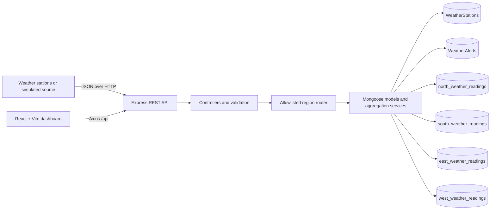

# SKYLINE – Geo-Distributed Weather Monitoring System

**Academic case study:** Geo-distributed database partitioning and query routing for remote weather stations.

## Project overview

SKYLINE is a college-level full-stack application that demonstrates how geographically distributed weather stations can report readings to a web service, and how an application can organize those readings into region-specific MongoDB collections. A responsive React dashboard consumes a Node.js/Express REST API backed by MongoDB and Mongoose.

The four weather-reading collections are **logical application-level partitions in one MongoDB database deployment**. This project does not configure or claim to be a production MongoDB sharded cluster. Its purpose is to make the data-placement and query-routing idea observable and testable at an undergraduate project scale.

## Abstract

Remote weather stations can generate high-volume time-series observations across geographically separated locations. This project presents an educational full-stack system that records station metadata, weather readings, and alerts; maps each station to one of four logical regions; routes regional reads and writes to the corresponding collection; and exposes dashboard and aggregation results through REST endpoints. A query-analysis page compares a single-collection routed query with a scatter-gather query over all four regional collections using equivalent filters. The system reports actual query and MongoDB explain metrics when available, rather than assuming or fabricating a performance advantage. Seeded and simulated records make the project usable without physical sensors.

## Problem statement

With one growing weather-data collection, it can be difficult for learners to see how region-aware data organization and targeted reads work. The project needs to demonstrate geographical routing in a practical application while clearly distinguishing application-level partitioning from native MongoDB horizontal sharding.

## Objectives

- Build a responsive weather-monitoring dashboard using the existing React/Vite frontend.
- Manage station metadata, readings, and alerts through an Express API.
- Validate a station's assigned region and route its reading to the matching logical collection.
- Support regional, multi-region, scatter-gather, and global queries.
- Show aggregation results and query-plan measurements from the configured database.
- Document setup, architecture, validation, limitations, and the distinction from native sharding.

## Existing and proposed systems

In a basic centralized design, all station readings may be placed in one collection and every region-level operation may search that collection. This is straightforward, but does not illustrate region-to-collection routing. SKYLINE's proposed demonstration keeps the database deployment simple while placing observations into four named regional collections. A controlled service resolves the region, selects a predeclared Mongoose model, and reports which collections were read. This is logical partitioning—not automatic distribution across database servers.

## Features

- Dashboard with station/readings/weather summaries and charts.
- Station search, filtering, details, and create flow.
- Live-monitoring view with controlled, explicitly simulated readings.
- Regional collection summaries and weather analytics.
- Geographical Analytics page for routed, scatter-gather, multi-region, and global query demonstrations.
- Alerts list and resolution interaction.
- Settings page and persistent UI theme preference.
- Labeled demo-data fallback when the database is unavailable; API health remains available while database-dependent APIs return `503`.

## Technology stack

| Layer | Technologies |
|---|---|
| Frontend | React, JavaScript, Vite, React Router, Axios, Recharts, Leaflet / React Leaflet, Lucide React, CSS |
| Backend | Node.js, Express, Mongoose, dotenv, CORS |
| Database | MongoDB Community Server or MongoDB Atlas; one configured database with logical regional collections |
| Validation | Node built-in test runner, backend syntax-check lint script, Oxlint, Vite production build, browser-driven checks |

## System architecture



In development, Vite proxies `/api` requests to `http://localhost:5000`. The API starts its HTTP server independently of MongoDB connection success, exposes a health route, retries database connection, and rejects data operations with `503` until the database is ready.

## MongoDB design and geographical regions

The database name defaults to `skyline_weather`. It contains:

| Data | Collection |
|---|---|
| Station records | `WeatherStations` |
| Alert records | `WeatherAlerts` |
| North readings | `north_weather_readings` |
| South readings | `south_weather_readings` |
| East readings | `east_weather_readings` |
| West readings | `west_weather_readings` |

The service maps `north`, `south`, `east`, and `west` to fixed Mongoose models. For a reading insert, the API resolves the station and uses its stored region; a conflicting supplied region is rejected. Regional reads select one model; all-region aggregations explicitly combine collections, including with MongoDB `$unionWith` where appropriate. This application-level routing is not MongoDB's `mongos` router and does not use a shard key.

## Regional routing and query comparison

The Geographical Analytics page and query API expose:

- **Routed:** select the region from the request or the station record and query that regional collection.
- **Scatter-gather:** query all four regional collections with an equivalent region/station/time filter and merge sorted results.
- **Multi-region:** query only the requested set of regional collections.
- **Global:** query all four collections without a region predicate.

The benchmark runs the routed and scatter-gather queries against the same filter and limit. Result retrieval time is measured independently of explain requests. Explain metrics may include documents and keys examined, documents returned, elapsed execution time, and winning-plan index names; unavailable metrics are reported as unavailable. Results vary with indexes, cache state, dataset size, load, and database environment. Routing reduces the collection access count for a regional query, but is not guaranteed to reduce elapsed time in every run.

## API overview

The local API base path is `/api`.

| Area | Routes |
|---|---|
| Health | `GET /health` |
| Stations | `GET /stations`, `GET /stations/:stationId`, `POST /stations`, `PUT /stations/:stationId`, `DELETE /stations/:stationId` |
| Readings | `GET /readings`, `GET /readings/region/:region`, `POST /readings`, `POST /readings/simulate`, `GET /readings/trends` |
| Query analysis | `POST /readings/query`, `POST /readings/benchmark`, `GET /readings/query-history` |
| Dashboard | `GET /dashboard/stats`, `GET /dashboard/overview`, `GET /dashboard/trends` |
| Regions | `GET /regions`, `GET /regions/:region`, `GET /regions/:region/stats` |
| Alerts | `GET /alerts`, `POST /alerts`, `PATCH /alerts/:alertId/resolve` |

See [API_DOCUMENTATION.md](docs/API_DOCUMENTATION.md) for request formats, filters, response metrics, and error behavior.

## Requirements and installation

- Node.js 20.19+ or 22.12+ and npm (required by the configured Vite toolchain).
- MongoDB Community Server 6.0+ locally, or a MongoDB Atlas deployment.
- PowerShell commands below are shown for Windows.

Install dependencies from the project root:

```powershell
cd backend
npm install
cd ..\frontend
npm install
```

## Environment configuration

Create local environment files from the examples:

```powershell
Copy-Item backend\.env.example backend\.env
Copy-Item frontend\.env.example frontend\.env
```

`backend/.env.example` contains `PORT`, `FRONTEND_ORIGIN`, `MONGODB_URI`, MongoDB selection timeout, and retry interval. For local MongoDB the example URI is `mongodb://127.0.0.1:27017/skyline_weather`. For Atlas, replace it with the private connection string and configure network access and a least-privilege database user. Do not commit credentials. `frontend/.env.example` uses `VITE_API_BASE_URL=/api`; Vite's development proxy targets the local backend.

## Seed and run

Start MongoDB, then seed the database (safe to rerun; deterministic station and reading keys are upserted):

```powershell
cd backend
npm run seed
```

Run the backend and frontend in separate terminals:

```powershell
cd backend
npm run dev
```

```powershell
cd frontend
npm run dev
```

Open the Vite URL (normally `http://localhost:5173`). The backend health endpoint is `http://localhost:5000/api/health`.

Optional index synchronization:

```powershell
cd backend
npm run indexes
```

Review manually managed indexes before running this command: Mongoose `syncIndexes()` removes undeclared indexes.

## Testing and verification

```powershell
cd backend
npm run lint
npm test
```

```powershell
cd frontend
npm run lint
npm run build
```

The recorded validation is **9 backend integration tests passed**, backend and frontend lint passed, production build passed, and both installed dependency trees reported zero vulnerabilities in `npm audit`. Browser checks exercised all eight application pages, principal interactions, and responsive widths from 320 to 1280 px. Database and performance measurements are specific to the local test environment. The isolated backend test database is `skyline_weather_test`; tests drop that database before and after the run. Never point `SKYLINE_TEST_MONGODB_URI` at data that must be retained. Full methods, measurements, and caveats are in [TESTING_REPORT.md](docs/TESTING_REPORT.md).

## Limitations

- Four logical collections are on one MongoDB database deployment; no MongoDB horizontal sharding, shard key, or `mongos` configuration is part of this project.
- The seed dataset is small and cannot represent production throughput.
- Live monitoring records are simulated, not received from physical sensors.
- Query history is in process memory and resets when the API restarts.
- UI fallback data is demonstration data and is labeled as such; it is not database persistence.
- No standalone frontend unit-test runner is currently configured; browser interactions were validated separately.
- Atlas deployment and production-scale performance were not tested.

## Future enhancements

- Add authenticated sensor ingestion and device identity management.
- Validate region assignment against station coordinates and an explicit geographic boundary dataset.
- Add durable query-history storage and a repeatable, larger benchmark dataset.
- Evaluate native MongoDB sharding in a separate multi-node deployment, with shard-key selection and measured operational trade-offs.
- Add automated frontend component/integration tests and continuous integration.
- Add configurable alert thresholds, retention policies, and production observability.

## Project structure

```text
SKYLINE-WEATHER-MONITOR/
├── backend/
│   ├── config/                 # MongoDB connection
│   ├── controllers/            # HTTP request handlers
│   ├── middleware/             # Database availability and error handling
│   ├── models/                 # Station, alert, regional reading models
│   ├── routes/                 # REST route maps
│   ├── scripts/                # Seed, lint, index synchronization
│   ├── services/               # Routing, aggregation, query analysis
│   ├── test/                   # Node test-runner integration suite
│   └── server.js
├── frontend/
│   ├── public/
│   └── src/
│       ├── assets/ components/ context/ data/ hooks/
│       ├── layouts/ pages/ services/ styles/ utils/
│       ├── App.jsx
│       └── main.jsx
├── docs/
│   ├── API_DOCUMENTATION.md
│   ├── ARCHITECTURE.md
│   ├── CASE_STUDY_REPORT.md
│   ├── DATABASE_DESIGN.md
│   ├── FINAL_CASE_STUDY_REPORT.md
│   ├── PRESENTATION_CONTENT.md
│   ├── SCREENSHOT_CHECKLIST.md
│   ├── TESTING_REPORT.md
│   └── VIVA_QUESTIONS.md
├── .gitignore
└── README.md
```

## Documentation

- [Architecture](docs/ARCHITECTURE.md)
- [Database design](docs/DATABASE_DESIGN.md)
- [API documentation](docs/API_DOCUMENTATION.md)
- [Case study summary](docs/CASE_STUDY_REPORT.md)
- [Final academic report](docs/FINAL_CASE_STUDY_REPORT.md)
- [Testing report](docs/TESTING_REPORT.md)
- [Viva questions and answers](docs/VIVA_QUESTIONS.md)
- [Presentation outline](docs/PRESENTATION_CONTENT.md)
- [Screenshot checklist](docs/SCREENSHOT_CHECKLIST.md)
