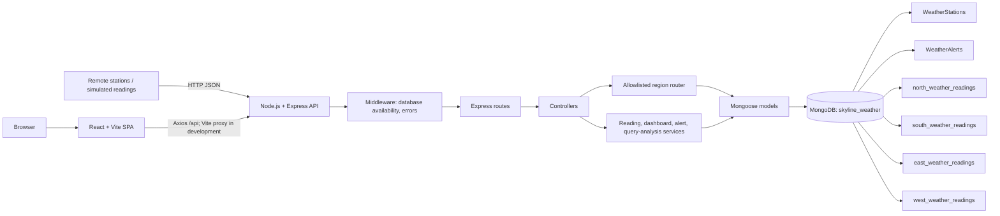
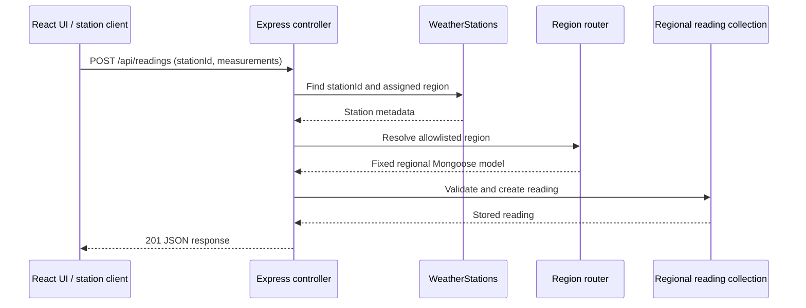
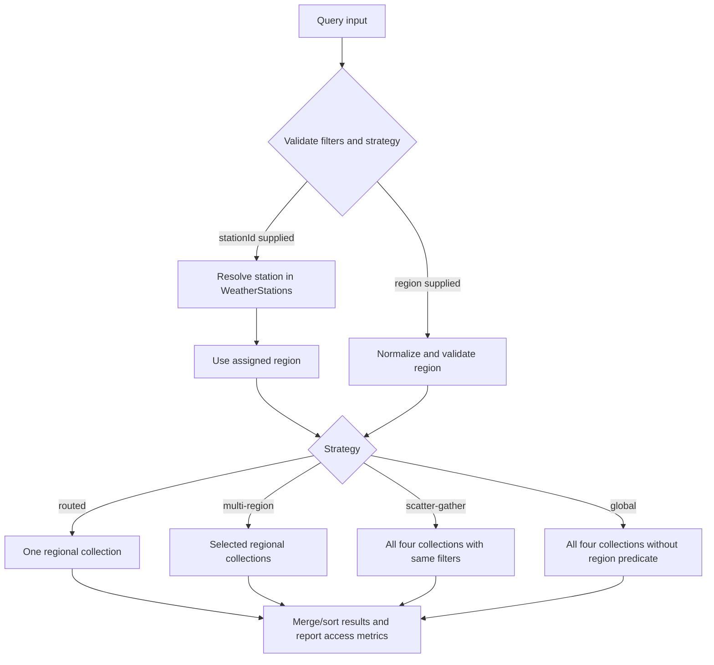

# SKYLINE System Architecture

## Purpose and scope

SKYLINE is an educational full-stack weather-monitoring application. Its focus is the application flow from station metadata to weather readings and the demonstration of region-aware logical collection routing.

> **Scope clarification:** `north_weather_readings`, `south_weather_readings`, `east_weather_readings`, and `west_weather_readings` are four collections in one configured MongoDB database deployment. They are logical application partitions, not a physical MongoDB sharded cluster. The project does not configure a shard key, call `shardCollection`, or deploy `mongos`.

## Component architecture

### Request and data flow

1. A user action or simulated station reading produces an HTTP request from the React application (or a caller) to the Express API.
2. Express parses JSON, checks database availability for data routes, and dispatches to a route/controller.
3. Controllers validate identifiers and query parameters; services encapsulate regional model selection and analytics.
4. A reading write resolves the station by `stationId`. The stored station region, not a client-provided collection name, determines the target model. A conflicting region is rejected.
5. Mongoose applies schema validation and indexes to operate on MongoDB.
6. Controllers return JSON. Errors pass through the centralized error handler.

## Frontend architecture

- `frontend/src/App.jsx` defines eight lazy-loaded page routes inside `AppDataProvider` and `AppLayout`.
- `frontend/src/layouts/AppLayout.jsx` provides responsive navigation and shared application framing.
- `frontend/src/pages/` contains Dashboard, Weather Stations, Live Monitoring, Regional Shards, Analytics, Geographical Analytics, Alerts, and Settings.
- `frontend/src/components/` contains shared panels, metrics, charts, station table, and station modal UI.
- `frontend/src/context/AppDataContext.jsx` loads shared station, alert, region, dashboard, and trend data from the API; maps responses to the UI model; and exposes loading and request-error states without replacing failed responses with sample weather records.
- `frontend/src/services/api.js` is the HTTP client boundary. In development Vite proxies `/api` to the backend.
- `frontend/src/data/displayData.js` contains fixed region display metadata and formatting helpers, not weather readings.
- Recharts renders analytical charts; Leaflet/React Leaflet dependencies are present for mapping interfaces.

The theme preference is stored in browser local storage. Seeded demonstration, monitoring-generated simulation, and unverified-ingest readings have distinct provenance labels. The application does not assert that unverified ingest is genuine sensor telemetry.

## Backend architecture

| Area | Responsibility |
|---|---|
| `server.js` | Starts HTTP server, retries MongoDB connection, and handles shutdown signals. |
| `app.js` | Configures CORS allowlist, JSON parsing, routes, database availability middleware, 404 handling, and centralized errors. |
| `routes/` | Maps REST paths to controller methods. |
| `controllers/` | Validate request values and translate service results into HTTP responses. |
| `services/regionRouter.js` | Normalizes and allowlists region names; returns fixed definitions and reading models. |
| `services/readingService.js` | Regional CRUD/query operations and `$unionWith` aggregation pipelines. |
| `services/queryAnalysisService.js` | Prepares filters, executes query strategies, requests explain statistics, and stores bounded in-memory history. |
| `services/dashboardService.js` | Produces dashboard summaries and trends. |
| `models/` | Mongoose station, alert, and four regional reading schemas. |
| `config/database.js` | Mongoose connection configuration. |
| `scripts/` | Deterministic seed, syntax-check lint, and index synchronization. |
| `test/` | Node built-in test-runner integration tests against an isolated database. |

## Region routing and query strategies

| Region input | Model collection |
|---|---|
| `north` / `North Region` | `north_weather_readings` |
| `south` / `South Region` | `south_weather_readings` |
| `east` / `East Region` | `east_weather_readings` |
| `west` / `West Region` | `west_weather_readings` |

The router normalizes case and the optional ` Region` suffix, then validates against a fixed map. Unsupported regions cause HTTP `400`; request values are never used as arbitrary MongoDB collection names.

The query analysis service provides:

- **Routed:** requires a region or station. A station query first reads its assigned region from `WeatherStations`, then accesses one regional reading collection.
- **Multi-region:** validates a requested region list and accesses only those collections.
- **Scatter-gather:** accesses all four regional collections. A selected-region predicate can be applied identically to each collection for comparison with a routed query.
- **Global:** accesses all four collections without a region predicate.

The response lists regional collections and metadata collections separately. If `stationId` is supplied, `WeatherStations` is a metadata lookup. Regional collection access count is therefore not always equal to total collection access count.

## MongoDB design, analytics, and indexes

`WeatherStations` stores station identity, assigned region, coordinates, GeoJSON Point, and status. `WeatherAlerts` stores alert lifecycle information. Each reading model uses the same schema and indexes but binds to one fixed regional collection.

Analytics explicitly combine collection data. The reading service uses `$unionWith` from a regional base collection for global reading statistics, regional aggregates, station summaries, and all-region trends. A regional trend targets only the selected collection. `WeatherStations` aggregation groups station records by region/status. Regional distribution is calculated from each reading count divided by the combined reading total.

Declared indexes include:

- Unique station and alert IDs.
- Station `{ region: 1, status: 1 }`, standalone status, and GeoJSON `location: 2dsphere`.
- Regional readings `{ stationId: 1, recordedAt: -1 }`, `{ recordedAt: -1 }`, `{ region: 1, recordedAt: -1 }`, and unique sparse `seedKey`.
- Alert status/date and region/status/date compounds.

The compound prefixes are used instead of redundant standalone `stationId` and `region` reading indexes. See [DATABASE_DESIGN.md](DATABASE_DESIGN.md) for field and index details.

## Benchmark methodology

`POST /api/readings/benchmark` prepares a single region/station/time filter and result limit, executes routed retrieval and scatter-gather retrieval, and measures each retrieval with Node's `performance.now()`. MongoDB `explain("executionStats")` is requested separately. The response includes accessed collections and explain documents/keys/index data when available. It does not impose artificial delays or promise a faster result. Small data volume, indexes, cache state, system load, and server configuration can affect timings. See [TESTING_REPORT.md](TESTING_REPORT.md) for the recorded local measurements and their scope.

## Availability and security boundaries

- `GET /api/health` is not behind database availability middleware.
- Database-dependent routes return `503` while MongoDB is unavailable.
- CORS allows configured frontend origins, and JSON body size is limited.
- Region keys are allowlisted; controllers construct explicit filters.
- Database credentials are environment configuration, not frontend code.
- The frontend does not substitute bundled weather values for unavailable API data; error banners and empty states distinguish request failure from an empty database.

## Deployment boundary

The documented run configuration is a local development setup, optionally using Atlas as a database endpoint. No production deployment topology, sensor network, horizontal cluster, or performance SLA is implied.
