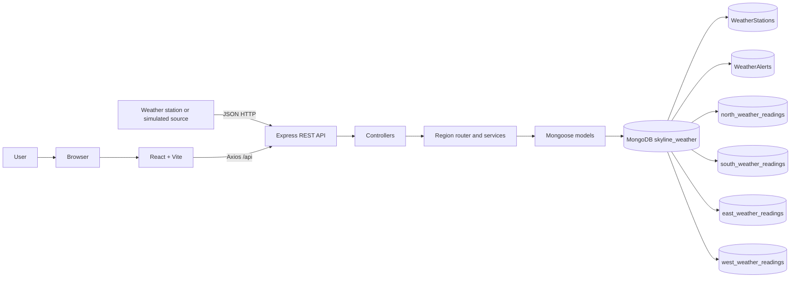
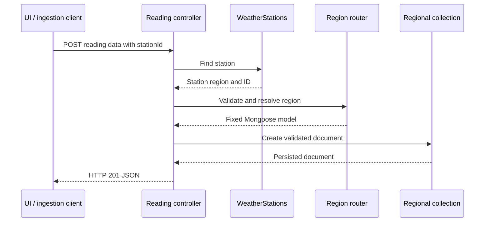
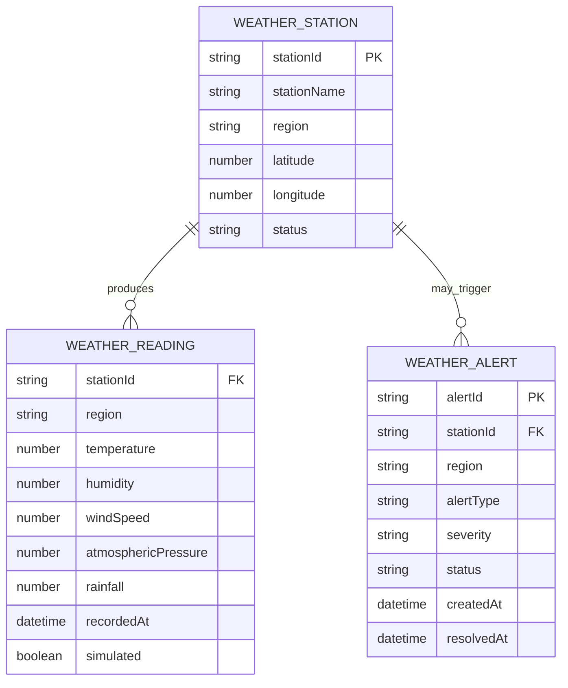
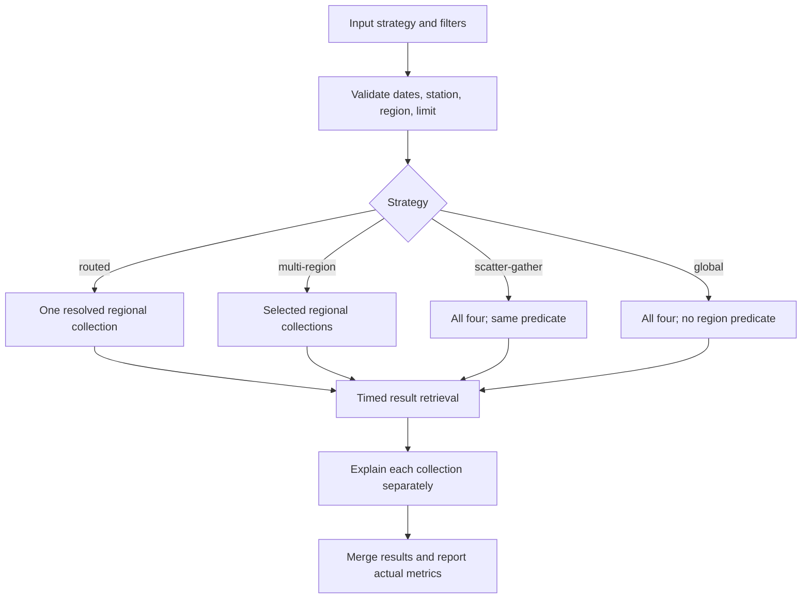

# SKYLINE – Geo-Distributed Weather Monitoring System

## Final Academic Case Study Report

**Case-study topic:** Geographical data partitioning and query routing for remote weather stations  
**Project type:** Undergraduate full-stack development and database case study  
**Implementation:** React/Vite, Node.js/Express, Mongoose, MongoDB

> **Scope statement:** SKYLINE demonstrates application-level logical regional partitioning with four collections in one configured MongoDB deployment. It does not configure or claim to be a production MongoDB horizontal-sharded cluster.

---

# Chapter 1: Introduction

## 1.1 Background

Weather stations measure environmental conditions such as temperature, humidity, wind speed, atmospheric pressure, and rainfall. A station may report repeatedly, making the resulting data naturally time-oriented. When many stations operate across a large area, a monitoring application must associate each observation with its station and location, store it reliably, and retrieve it for dashboards, regional summaries, and analysis.

This project uses a web application and MongoDB to illustrate those concepts. Station metadata is stored separately from time-series readings. Each station is assigned one of four application regions—North, South, East, or West—and the backend uses that assignment to select one of four regional reading collections.

## 1.2 Introduction to distributed weather monitoring

A distributed monitoring system consists of data-producing devices located at different sites and a service that receives and presents their observations. In a deployed system, devices may communicate over networks with varying connectivity and may produce data at different rates. SKYLINE models the core software flow without requiring physical hardware: a REST endpoint accepts a reading, and a controlled simulation endpoint can generate readings marked `simulated`.

The application separates station identity from observations. A reading references a station ID and region, along with measurement values and a timestamp. This arrangement permits historical queries and aggregation while keeping the station's location and current status in a dedicated collection.

## 1.3 Project motivation

Database distribution and query routing can be difficult to understand from diagrams alone. SKYLINE makes a simplified routing decision visible: a regional request can touch one logical regional collection, while a scatter-gather request checks all four. It also exposes MongoDB explain statistics when supported and compares equivalent query filters. The interface and seeded data make this demonstration accessible without sensors or paid services.

## 1.4 Problem statement

The project addresses the educational problem of demonstrating how geographically classified weather readings can be organized and queried without presenting logical partitions as physical shards. A learner should be able to observe:

- how station metadata determines a reading's region;
- how the backend maps a validated region to a fixed model and collection;
- how regional and global query strategies differ in collection access;
- how indexes and explain output inform query analysis; and
- why local timing measurements do not establish a universal performance advantage.

## 1.5 Objectives

1. Implement a full-stack weather-monitoring application.
2. Provide station, reading, alert, dashboard, and analysis APIs.
3. Store station and alert data in dedicated MongoDB collections.
4. Route readings into four logical regional collections.
5. Implement regional, multi-region, scatter-gather, and global queries.
6. Compare routed and scatter-gather results using equivalent filters.
7. Visualize dashboard statistics, trends, region distribution, and query metrics.
8. Validate behavior and document actual outcomes and limitations.

## 1.6 Scope

Included: React pages, Express API, Mongoose schemas, MongoDB persistence, seed data, controlled simulated readings, aggregation pipelines, query explain analysis, and academic documentation.

Excluded: physical sensor integration, production authentication, a production SLA, multi-node MongoDB shard deployment, a native shard key, `mongos`, and production-scale throughput evaluation.

---

# Chapter 2: Literature and Technology Review

## 2.1 React

React is a JavaScript library for building user interfaces from reusable components. A component describes a part of the interface and can render differently as its properties or state changes. In SKYLINE, pages and shared components divide the dashboard into maintainable pieces. React state and context hold data used by multiple pages, while React Router maps URLs to page components.

React itself does not provide the application database or HTTP API. SKYLINE uses Axios for API calls, React Router for navigation, and Recharts for charts.

## 2.2 Node.js and Express

Node.js provides a JavaScript runtime outside the browser and supports server-side applications. Express is a web framework for defining HTTP routes and middleware. In SKYLINE, Express parses JSON, applies CORS configuration, exposes REST routes, and directs requests to controllers. Services isolate reusable database and routing logic from HTTP concerns.

The backend starts its HTTP server even if MongoDB is unavailable. The health endpoint remains available; middleware prevents database-backed operations from proceeding and returns `503` until the database connection is ready.

## 2.3 MongoDB and Mongoose

MongoDB is a document database that stores records as BSON documents in collections. Documents in a collection can represent weather observations with fields such as `stationId`, `temperature`, `humidity`, and `recordedAt`. MongoDB supports indexes and aggregation operations for filtering, sorting, grouping, and combining data.

Mongoose is the Node.js object-document mapper used here. It defines schemas, validates application data, declares indexes, and provides model APIs. SKYLINE binds a common reading schema to four explicitly named collections. Mongoose schema validation is an application-level guard; MongoDB query results and API input are also controlled through server-side validation.

## 2.4 Geographical data partitioning

Partitioning divides a dataset into smaller logical or physical parts according to a chosen rule. In SKYLINE, the rule is the station's assigned region. The application maps each allowed region to a fixed collection. A regional query can target only the corresponding collection; a query spanning regions must access multiple collections.

This is **logical application-level partitioning**. The four collections reside in the same configured database deployment. It can illustrate data organization and query access patterns, but does not itself distribute storage across multiple machines.

## 2.5 MongoDB horizontal sharding

MongoDB horizontal sharding is a cluster deployment feature that distributes data across multiple shards. A shard key is a field or compound field pattern used to distribute and target data. A `mongos` query router directs requests to appropriate shards in a sharded deployment.

SKYLINE does not run a sharded cluster, define or deploy a shard key, execute `shardCollection`, or configure `mongos`. Its backend region router is application code and must not be confused with MongoDB's native cluster router.

## 2.6 REST APIs

REST-style APIs expose resources over HTTP using methods such as GET, POST, PUT, and PATCH. They use standard HTTP status codes to indicate outcomes. SKYLINE uses JSON request and response bodies. For example, `POST /api/readings` creates a reading, while `GET /api/readings/region/:region` retrieves readings from a specified logical region.

## 2.7 Data aggregation

Aggregation pipelines process documents through ordered stages. Stages can filter (`$match`), sort (`$sort`), group (`$group`), project fields (`$project`), or combine collections (`$unionWith`). SKYLINE uses pipelines for regional totals, average measurements, trends, dashboard summaries, and cross-region reading analytics.

---

# Chapter 3: System Analysis

## 3.1 Existing system

A simple weather-data application could place all readings in one collection and query that collection for every dashboard operation. This can be sufficient for small datasets and easy to implement. It does not by itself show how an application might route work based on station geography.

## 3.2 Drawbacks of a basic centralized approach

- The relationship between station region and reading storage is less explicit.
- A region-specific query may need to examine data unrelated to its target region, depending on collection organization and indexes.
- Learners cannot directly observe the difference between one-region access and an all-region search.
- The design alone does not demonstrate the separate responsibilities of application routing and native cluster sharding.

These are educational trade-offs, not a claim that one collection is inherently unsuitable or slow.

## 3.3 Proposed system and advantages

SKYLINE maintains station metadata and alerts separately and maps each station to one of four reading collections. The backend uses fixed models and an allowlisted region router. Query analysis reports accessed collections and explain metrics where available. This design:

- makes region-to-collection mapping explicit;
- illustrates a routed and scatter-gather query strategy;
- supports regional and cross-regional aggregation;
- avoids arbitrary collection selection from request input; and
- clearly labels the boundary between logical partitioning and actual sharding.

## 3.4 Functional requirements

1. List, create, retrieve, update, and delete weather stations.
2. Store readings in the collection assigned to the station's region.
3. Retrieve readings by station, region, time, or across regions.
4. Generate explicitly marked simulated readings for monitoring.
5. Summarize station, reading, and weather information for dashboard pages.
6. Create and resolve weather alerts.
7. Compare routed and scatter-gather queries and display actual available metrics.
8. Display loading, error, empty, connected, and labeled fallback states where implemented.

## 3.5 Non-functional requirements

- **Maintainability:** separate frontend pages/components and backend routes/controllers/services/models.
- **Validation:** restrict region values and validate schema fields and API filters.
- **Availability behavior:** expose health while database connection retries continue; return `503` for unavailable database operations.
- **Usability:** responsive interface with search, filters, charts, and navigable pages.
- **Transparency:** distinguish simulated data and logical partitions from production sensor and shard infrastructure.

## 3.6 Hardware requirements

No specialized hardware is required for development. A computer capable of running a supported Node.js version, browser, and local MongoDB instance is sufficient. The project does not specify measured minimum CPU, memory, or storage requirements.

## 3.7 Software requirements

- Node.js 20.19+ or 22.12+ with npm for the configured Vite toolchain.
- MongoDB Community Server 6.0+ or a MongoDB Atlas deployment.
- A modern browser.
- Dependencies listed in `backend/package.json` and `frontend/package.json`.

---

# Chapter 4: System Design

## 4.1 System architecture



## 4.2 Architecture explanation

The frontend is a single-page React application. Vite serves it during development and proxies `/api` requests to the Express API. Express routes requests to controllers. Controllers and services validate input and call Mongoose models. The region router uses a fixed region-to-model mapping. MongoDB stores stations, alerts, and readings. A common reading schema is bound to four collection names.

## 4.3 Data flow



## 4.4 Module description

- **Dashboard:** summary counts, weather metrics, trends, regional distribution, recent activity.
- **Weather Stations:** searchable/filterable station list and station details/create interaction.
- **Live Monitoring:** station/region/range filters, charts, and simulated readings.
- **Regional Shards:** collection-level regional data summary; “shards” is a UI label for the case study and is not a statement of MongoDB cluster sharding.
- **Analytics:** regional and weather trend charts.
- **Geographical Analytics:** query strategy selection, query execution, benchmark, metrics, and history.
- **Alerts:** alert listing/filtering and resolution.
- **Settings:** profile/preferences and application configuration display.
- **Backend services:** regional routing, readings, dashboard aggregation, and query analysis.

## 4.5 Database design and relationships

Collections:

| Collection | Main key data |
|---|---|
| `WeatherStations` | Unique `stationId`, station name, assigned region, coordinates, GeoJSON Point, status, timestamps |
| `WeatherAlerts` | Unique `alertId`, `stationId`, region, alert type, severity, status, creation/resolution time |
| `north_weather_readings` | Station ID, region, measurements, recorded time, simulation flag |
| `south_weather_readings` | Same reading schema |
| `east_weather_readings` | Same reading schema |
| `west_weather_readings` | Same reading schema |



These relationships are references by identifier; the schema does not declare a relational foreign-key constraint. The reading collection is determined by the station's region.

## 4.6 Regional routing algorithm

1. Normalize the submitted region (case and optional `" Region"` suffix).
2. Verify that it belongs to `north`, `south`, `east`, or `west`.
3. Retrieve the corresponding model from the predefined mapping.
4. On reading creation, first look up the station; use the stored region.
5. Reject a supplied region that conflicts with the station record.
6. Execute the operation against the selected model.

The implementation's mapping is:

```js
const REGIONS = Object.freeze({
  north: Object.freeze({ id: 'north', name: 'North Region', collection: 'north_weather_readings' }),
  south: Object.freeze({ id: 'south', name: 'South Region', collection: 'south_weather_readings' }),
  east: Object.freeze({ id: 'east', name: 'East Region', collection: 'east_weather_readings' }),
  west: Object.freeze({ id: 'west', name: 'West Region', collection: 'west_weather_readings' }),
})
```

This excerpt is from `backend/services/regionRouter.js`; the production map also carries display colors.

## 4.7 Query processing algorithm

The query-analysis service prepares a station/region/time filter, validates date order and limit, selects one or more regions based on strategy, reads the selected collections, sorts and merges results, records regional and metadata collection access, then requests explain statistics. A station lookup is recorded as metadata access. Explain failures produce unavailable values rather than fabricated statistics.



---

# Chapter 5: Implementation

## 5.1 React frontend

`frontend/src/App.jsx` defines routes for the eight pages and lazy-loads each page inside a shared layout and data provider. `AppDataContext` requests health, stations, alerts, regional summaries, dashboard statistics, and trends. API responses are translated to view data. If MongoDB is not available, the UI uses labeled demo data. The API client is in `frontend/src/services/api.js`. Recharts is used for visualizations.

## 5.2 Backend architecture

The backend uses CommonJS modules. `server.js` launches Express, connects to MongoDB with retry behavior, and closes the HTTP server and database connection on shutdown. `app.js` configures CORS, JSON parsing, routes, database availability middleware, and centralized errors. Routes are grouped by stations, readings, dashboard, regions, alerts, and health.

## 5.3 MongoDB connection

The connection string is read from `MONGODB_URI`; defaults and operational values are documented in `backend/.env.example`. The backend does not require the database to start its health endpoint. When MongoDB is unavailable, the server retries and database-dependent endpoints return `503`.

## 5.4 Weather station management

The station schema validates unique uppercase station IDs, required names and regions, numeric latitude/longitude ranges, GeoJSON Point coordinates, and status values. Station list APIs accept optional region/status/search/limit filters. CRUD endpoints are documented in `API_DOCUMENTATION.md`.

## 5.5 Weather readings and partitioning

The reading schema validates measurement ranges, station ID, region, and time. A dynamic model factory binds the same schema to the four fixed regional collection names. The reading creation controller looks up the station and uses its assigned region. It rejects region mismatch and creates the record through the region model.

Actual implementation excerpt from `backend/models/WeatherReading.js`:

```js
function getWeatherReadingModel(region) {
  const { id, collection } = getRegion(region)
  if (!modelCache.has(id)) {
    const modelName = `WeatherReading_${id}`
    modelCache.set(id, mongoose.models[modelName]
      || mongoose.model(modelName, weatherReadingSchema, collection))
  }
  return modelCache.get(id)
}
```

The seed script upserts 20 stations, 200 deterministic readings (50 in each region), and five alerts. The development database observed during testing had one additional simulated North reading, for 201 total; seed output and live database state are distinct.

## 5.6 Geographic routing

`backend/services/regionRouter.js` centralizes region normalization and validation. Unsupported values raise an API error with HTTP `400`. Model selection comes from the fixed definitions, so input cannot specify an arbitrary collection name. Regional reading operations use the selected model; cross-region operations explicitly iterate or combine the four models.

## 5.7 Alerts

The alert model validates alert type, severity, status, and message. Alerts are associated with a station ID and region. The API supports listing, creation, and resolution. Resolution updates the alert status and timestamp.

## 5.8 Analytics and dashboard

`readingService.js` uses aggregation pipelines. `$unionWith` combines regional collections for overall statistics, per-region counts and averages, per-station summaries, and all-region trends. Regional trend requests target a single collection. `$dateTrunc` groups results into hourly or daily periods. Dashboard services combine reading aggregates and station summaries.

## 5.9 Query benchmarking and explain

The query analysis service supports routed, multi-region, scatter-gather, and global strategies. It times result retrieval with Node's `performance.now()`. It then invokes MongoDB `explain("executionStats")` separately for each queried regional collection. It reports collection access, documents examined/returned, keys examined, execution time, and index name when available. Metrics unavailable from MongoDB are represented as null and displayed as N/A.

The benchmark runs the same regional/station/time filter and result limit for routed and scatter-gather queries. It does not manipulate timing or assert that routing is always faster. Query history is limited to 100 entries and remains in process memory.

## 5.10 Dashboard

The dashboard combines station totals and active status, overall reading count, region count, average weather values, region distribution, recent station activity, and trends. Connected database values come from the API. Offline demo values are labeled and must not be treated as persisted MongoDB data.

---

# Chapter 6: Results and Discussion

## 6.1 Screenshots

This report does not include generated or fabricated screenshots. Capture the running application itself for an academic submission. The pages and states to capture are listed in [SCREENSHOT_CHECKLIST.md](SCREENSHOT_CHECKLIST.md), including the Dashboard, Weather Stations, Live Monitoring, Regional Shards, Analytics, Geographical Analytics, query comparison, Alerts, and Settings.

## 6.2 Dashboard results

Browser validation confirmed all eight application routes rendered expected headings. The connected development dataset contained 20 stations and 201 readings. Dashboard, trends, charts, and regional distribution were exercised against MongoDB-backed data. These figures are a test snapshot, not immutable project constants; the seeded baseline is 20 stations and 200 readings.

## 6.3 Weather station results

Browser checks exercised station search, region filtering, a station detail view, and station creation. Backend integration tests exercised station create, list, get, update, and delete. The temporary UI-created station was removed after testing.

## 6.4 Regional collection distribution

During validation, the development database contained:

| Region | Collection | Reading count |
|---|---|---:|
| North | `north_weather_readings` | 51 |
| South | `south_weather_readings` | 50 |
| East | `east_weather_readings` | 50 |
| West | `west_weather_readings` | 50 |
| **Total** | — | **201** |

North contained a previously generated simulated record in addition to the 50 seeded readings.

## 6.5 Geographical analytics and query comparison

The browser exercised regional summaries and routed, scatter-gather, global, and multi-region query interfaces. For the South test, each strategy used equivalent South-region filters and a 50-record result cap. Both returned 50 matching records. Routed queried one regional collection; scatter-gather queried all four. The local observed measurements from the testing report are:

| Run | Routed API elapsed | Scatter-gather API elapsed | Documents examined (routed / scatter) | Results returned | Regional collections (routed / scatter) |
|---|---:|---:|---:|---:|---:|
| API run 1 | 15.768 ms | 49.702 ms | 50 / 50 | 50 / 50 | 1 / 4 |
| API run 2 | 6.549 ms | 147.760 ms | 50 / 50 | 50 / 50 | 1 / 4 |
| Browser run | 8.627 ms | 379.350 ms | 50 / 50 | 50 / 50 | 1 / 4 |

The explain plans reported the `region_1_recordedAt_-1` index for these runs. These are actual local observations from a small dataset. The variation in timings is material; the result demonstrates fewer regional collection accesses for this query but does not prove a guaranteed latency benefit.

A separate indexed versus forced `$natural` scan comparison used 12 alternating samples, the same station filter/sort, and the same 10 returned readings:

| Strategy | Median observed elapsed | Explain documents examined | Explain keys examined | Explain results |
|---|---:|---:|---:|---:|
| Indexed | 6.738 ms | 10 | 10 | 10 |
| Forced scan | 9.331 ms | 50 | 0 | 10 |

Observed outliers and the small database limit the conclusion. Explain timing itself had millisecond granularity and is not identical to API result-retrieval time.

## 6.6 Actual testing results

The documented verification recorded:

- 9 backend integration tests passed, 0 failed.
- Backend lint, frontend lint, and Vite production build passed.
- Backend and frontend `npm audit` each reported 0 vulnerabilities at test time.
- Four regional collections, index declarations, routing behavior, CRUD, alert resolution, aggregation, and persistence across backend restart were checked.
- Database failure behavior was checked: the health endpoint remained available while data routes returned `503`.
- Browser checks covered eight pages, station operations, alert resolution, monitoring filters/charts, query UI, theme persistence, loading/offline fallback/retry, and viewport widths 320–1280 px.

Refer to [TESTING_REPORT.md](TESTING_REPORT.md) for case-by-case expected and actual results.

## 6.7 Discussion

The core demonstration is architectural: a fixed mapping allows the application to route a regional query to one logical collection, while a scatter-gather operation visits four. The collection access count is deterministic for the strategy; elapsed time is an observation influenced by database and host conditions. The small dataset is appropriate for demonstrating functionality but not for projecting production performance. Native MongoDB sharding would be a separate deployment experiment and is outside this project's tested scope.

---

# Chapter 7: Conclusion and Future Scope

## 7.1 Conclusion

SKYLINE implements a working full-stack demonstration of weather station management, MongoDB persistence, region-based logical partitioning, query routing, and dashboard analytics. The system ties a station's assigned region to the collection used for its readings. It exposes regional and cross-region query strategies and reports actual explain data and execution measurements where available.

## 7.2 Achievements

- Implemented the React dashboard and eight navigable pages.
- Created Express REST API and Mongoose models.
- Added four logical reading collections and allowlisted routing.
- Added seeding, aggregation pipelines, indexes, alert lifecycle, and simulated observations.
- Added query strategy analysis and routed/scatter-gather comparison.
- Verified backend tests, build/lint, selected browser interactions, and local persistence.
- Documented limitations without presenting logical collections as a production sharded cluster.

## 7.3 Current limitations

- One configured MongoDB deployment with four logical collections; no horizontal sharding configuration.
- Small seeded dataset and environment-specific benchmark measurements.
- Simulated readings instead of physical weather sensors.
- Query history is memory-only and resets when the backend restarts.
- No production authentication, authorization, retention policy, or formal service-level objective.
- No separate automated frontend unit-test runner is configured.
- The test report's dependency audit reflects the dependency state at test time; it is not a permanent guarantee.

## 7.4 Future enhancements

- Integrate authenticated physical devices and resilient ingestion queues.
- Use explicit geographic boundaries to validate station-region assignment.
- Persist query history and support repeatable multi-size benchmark fixtures.
- Evaluate a real MongoDB sharded deployment separately, including shard-key selection and operational behavior.
- Add frontend automated tests, CI checks, authentication, observability, and configurable alert thresholds.

---

# Chapter 8: References

The following are official product documentation sources; no research papers or unverified bibliographic references are cited.

1. React, **React Documentation**, https://react.dev/ (accessed 11 November 2026).
2. MongoDB, **MongoDB Manual**, https://www.mongodb.com/docs/manual/ (accessed 11 November 2026).
3. MongoDB, **Sharding**, https://www.mongodb.com/docs/manual/sharding/ (accessed 11 November 2026).
4. MongoDB, **Aggregation Pipeline**, https://www.mongodb.com/docs/manual/core/aggregation-pipeline/ (accessed 11 November 2026).
5. MongoDB, **Explain Results**, https://www.mongodb.com/docs/manual/reference/explain-results/ (accessed 11 November 2026).
6. Node.js, **Node.js Documentation**, https://nodejs.org/docs/ (accessed 11 November 2026).
7. Express, **Express Documentation**, https://expressjs.com/ (accessed 11 November 2026).
8. Vite, **Vite Documentation**, https://vite.dev/guide/ (accessed 11 November 2026).
9. Mongoose, **Mongoose Documentation**, https://mongoosejs.com/docs/ (accessed 11 November 2026).

## Appendix: Supporting project documents

- [API documentation](API_DOCUMENTATION.md)
- [Architecture](ARCHITECTURE.md)
- [Database design](DATABASE_DESIGN.md)
- [Testing report](TESTING_REPORT.md)
- [Viva questions](VIVA_QUESTIONS.md)
- [Presentation outline](PRESENTATION_CONTENT.md)
- [Screenshot checklist](SCREENSHOT_CHECKLIST.md)
